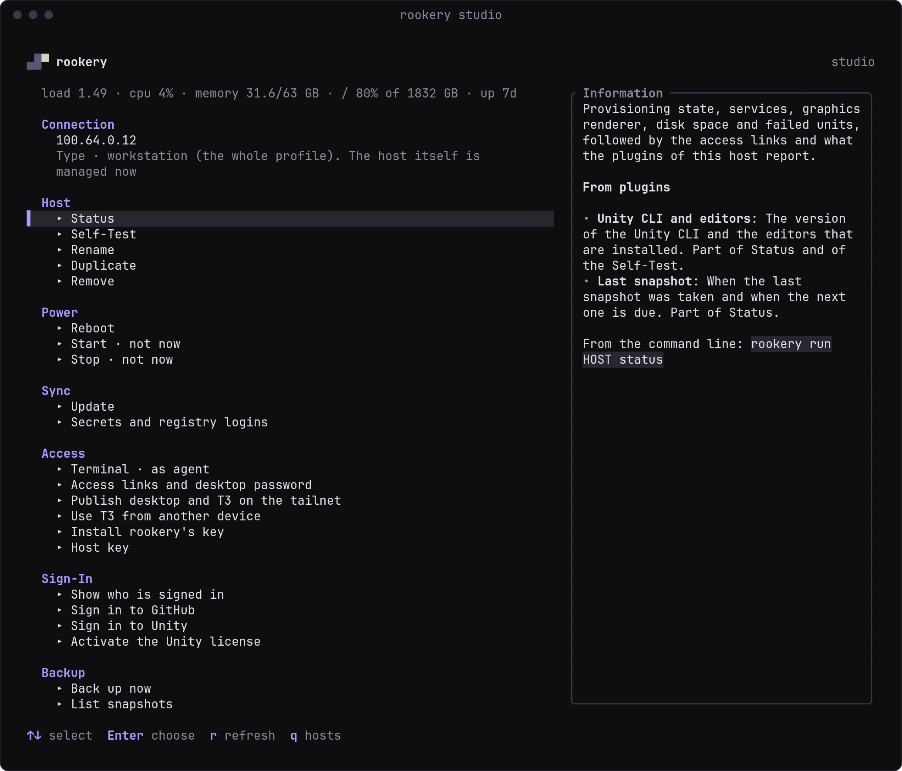

# Rookery

Rookery sets up Ubuntu 26.04 hosts for coding agents on a spare laptop, a
server or a container, and manages them from your terminal. It can also create
the machines, through provisioner plugins.

A host runs XFCE on a virtual display that you open in a browser. The coding
agents come from plugins, installed like any other plugin. Each host has a
profile that Rookery installs and can apply again. Once the host runs, its page
in Rookery has the status, sign-ins, updates and secrets. A machine you only log in to can be
a host too: `rookery host add forge 192.0.2.4 --user ops`.



**Status:** early. Try a profile in the container or a VM before booting the
installer on real hardware: **the installer erases the disk it selects.**

## Install

On Linux or macOS:

```bash
curl -fsSL https://raw.githubusercontent.com/aiviarium/rookery/main/install.sh | sh
```

The script installs the latest release to `~/.local/bin` after checking its
SHA-256. On other architectures, build it:

```bash
rustup target add x86_64-unknown-linux-musl
cargo install --locked --git https://github.com/aiviarium/rookery rookery
```

Setting up hosts also needs `ssh`, `python3` and `ansible-playbook` on your
machine. Rookery is also an image, `ghcr.io/aiviarium/rookery`, which runs its
local API server by default.

On macOS and Windows Rookery uses the hosts of a Rookery server elsewhere, with the
same screens. `install.sh` installs it on macOS too, and on Windows:

```powershell
irm https://raw.githubusercontent.com/aiviarium/rookery/main/install.ps1 | iex
```

## Quick start

```bash
rookery studio          # a new host: choose how to install, features and settings
rookery                 # the home screen with all hosts
rookery run studio status
```

A new host opens on its Install tab, where you choose how to install it. The
methods are a machine a plugin creates, a USB installer, a cloud-init seed, SSH
to an existing Ubuntu server, and a container image. Features and Settings
follow, and Run installs it. Once it runs, `rookery studio` opens its overview, where you sign the
agents in and find the address of its desktop.

## Documentation

The documentation site is built from [`docs/`](docs) (`cd docs && npm install && npm run dev`).

- [Getting started](docs/content/docs/%28guide%29/start/install.mdx): installing Rookery and a first host.
- [Deploying](docs/content/docs/%28guide%29/deploy/index.mdx): the install methods, and testing in QEMU.
- [Using Rookery](docs/content/docs/%28guide%29/use/index.mdx): the terminal UI and commands, sign-ins, secrets and updates.
- [Extending](docs/content/docs/%28guide%29/extend/index.mdx): plugins, services and `rookery serve`.
- [Reference](docs/content/docs/%28guide%29/reference/index.mdx): tools, `box`, profile fields, building and releasing.
- The API reference of rookeryd and `rookery serve`, generated from [`docs/openapi/`](docs/openapi).

## Contributing and security

[CONTRIBUTING.md](.github/CONTRIBUTING.md) says what Rookery is meant to be and how changes
get in. Open an issue before a pull request. [SECURITY.md](.github/SECURITY.md) says how
to report a vulnerability and where Rookery's API is meant to be reachable from.

## License

Licensed under either of the [Apache License, Version 2.0](LICENSE-APACHE) or
the [MIT license](LICENSE-MIT), at your option. Contributions are licensed the same way.

The vendored `tui-input` crate under `crates/vendor` has its own MIT license. The
agents and tools that plugins install, such as coding agents and Unity,
are separate products under their vendors' terms. Rookery doesn't include them,
and a plugin downloads them from their vendors.
